  &nbsp;
  

  &nbsp;&nbsp;
  &nbsp;&nbsp;
  &nbsp;&nbsp;
  &nbsp;&nbsp;

  
  

  

<h2 align="center">About</h2>

- 🏢 Building at **[Alpha.Kore](https://www.alphakore.org/)**: a small studio turning sparks into impact
- 📍 Vadodara, Gujarat, India
- 🤖 Working on AI agents, automation and web products
- 🌱 Learning Python, machine learning and DSA, one day at a time

<h2 align="center">Languages · Frameworks · Tools</h2>
 

  
   
  

<h2 align="center">Featured work</h2>

<table align="center">
  <tr>
    <td align="center"><a href="https://github.com/Neverfinished005/AGENTOS-"><b>AGENTOS</b></a> Runtime safety guard for LangChain and Python agents</td>
    <td align="center"><a href="https://github.com/Neverfinished005/ORBITGAURD"><b>ORBITGAURD</b></a> 3D space situational awareness for collision avoidance</td>
    <td align="center"><a href="https://github.com/Neverfinished005/demandanalyzer"><b>demandanalyzer</b></a> ML sales and demand forecasting</td>
  </tr>
</table>

