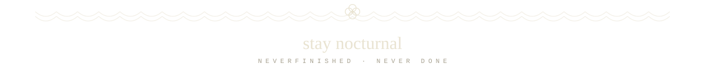

<div align="center">



<br>

<sub><sup>cover art &mdash; Kentaro Miura, <i>Berserk</i></sup></sub><br>
<sub><code>i spawn at night &middot; code &middot; explore &middot; watch stars &middot; admire nature</code></sub>

</div>



```yaml
codename:    Neverfinished005
real_name:   Rudra Vable
domain:      Vadodara, Gujarat, India
class:       Aspiring Software Developer
spells:      Python / Machine Learning / SQL / DSA / Mobile Apps
active_hours: after dark
status:      open to SDE and ML / AI roles
```

I'm building a solid foundation in **Python, machine learning, SQL, data structures and algorithms, and mobile apps**. Most of what I know comes from academic and personal projects: ML models, databases and apps. I like practical things that work, and I'm always learning the next one.



<p align="center">
           
</p>



<table align="center">
  <tr>
    <td align="center" width="33%"><a href="https://github.com/Neverfinished005/AGENTOS-"><b>AGENTOS</b></a><br><sub>Runtime safety guard for LangChain and Python agents</sub></td>
    <td align="center" width="33%"><a href="https://github.com/Neverfinished005/ORBITGAURD"><b>ORBITGAURD</b></a><br><sub>3D space situational awareness for collision avoidance</sub></td>
    <td align="center" width="33%"><a href="https://github.com/Neverfinished005/demandanalyzer"><b>demandanalyzer</b></a><br><sub>ML forecasting of seasonal sales and demand</sub></td>
  </tr>
</table>








